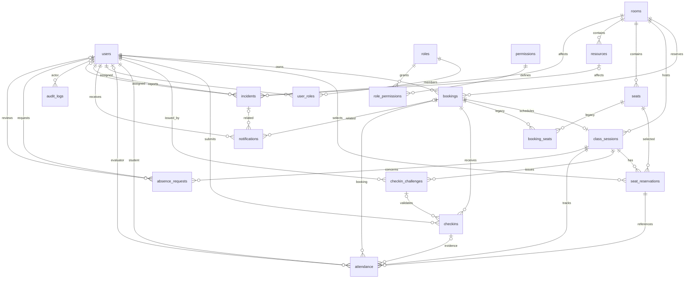

# Demo DB/security (8–10 phút)

**Bổ sung demo resources:** seed 004 có thiết bị cố định cho A/B/C; bộ release hiện **001–016**. Trong `tests/verify_reservation_constraints.sql`, test chứng minh cùng nhóm máy tính có nhiều incident, sự cố chung cho phép resource NULL, chọn thiết bị khác phòng bị FK 016 chặn. Một máy hỏng chỉ ghi mô tả incident; tổng quantity vẫn 30, không tự đổi trạng thái cả nhóm. FK ghép củng cố quan hệ trong ERD có sẵn, không thêm bảng mới.

**Bổ sung demo giữ ghế:** xem [SEAT_HOLDS.md](SEAT_HOLDS.md), chạy `tests/verify_seat_holds.sql` trên DB thử và mở `evidence/seat-hold-race.log`: hai kết nối tranh cùng ghế, một thành công, một bị 23505. Trình bày PENDING → CONFIRMED; hết hạn được view coi là AVAILABLE và được hàm giữ ghế thu hồi. Backend/UI chưa tích hợp tính năng này. Bộ release hiện 001–015.

Chạy trên DB thử, không trên CNPM. Mở `RELEASE_RC.md` và `evidence/RESULT.txt` trước demo. Trình bày rõ phạm vi: DB constraint/RLS mẫu/backup; UI login hiện là mock.

1. **Schema (1 phút):** giới thiệu ERD bên dưới, booking là nguồn lịch phòng; session khớp phòng/giờ booking qua FK ghép; ghế phải cùng phòng session.
2. **Constraint (2 phút):** chạy `tests/verify_reservation_constraints.sql` bằng psql ON_ERROR_STOP=1. Các test chủ động bắt lỗi mong đợi, kết thúc rollback; giải thích booking giao giờ bị chặn, nối tiếp giờ được phép, ghế/người chỉ có một lượt CONFIRMED/session. Identity có thể tăng dù rollback.
3. **Check-in (1 phút):** chạy `tests/verify_checkin_codes.sql`. Mô tả giáo viên/admin cấp mã trong giờ buổi học confirmed; sinh viên có ghế confirmed mới nộp được; QR/manual đi cùng đường ghi attendance. Không hiển thị token thật của buổi học thật.
4. **Security DB (1 phút):** chạy `tests/release_rls.sql`. Role thử không sở hữu bảng/không bypass; chỉ thấy notification của mình; thiếu context không thấy dữ liệu. Nói rõ đây là context do backend tin cậy cung cấp, không phải tính năng login đã hoàn tất.
5. **Query/index (1 phút):** mở `evidence/release_query_plan.log`: 10.000 booking tổng hợp, Index Scan theo room/time. Chạy lại `tests/release_query_plan.sql` nếu cần, chỉ trên DB thử.
6. **Backup/restore (2 phút):** chạy `scripts/Test-Release.ps1` trên server thử hoặc mở log lần đã chạy. Hiển thị RESULT/SHA256 và hai fingerprint giống nhau; restore dùng DB mới và `--exit-on-error`; integrity chạy lại sau restore. Không coi dump thành công là restore thành công.
7. **Giới hạn (1 phút):** UI chỉ mock `admin/admin123`, chưa kiểm DB password/role. Không trình bày UI như bằng chứng authentication. Chỉ ra các mục cần quyết định trong RELEASE_RC.

Ví dụ gọi SQL (đổi DB bằng tên Source trong RESULT, cùng host/port):

```powershell
& 'C:\Program Files\PostgreSQL\18\bin\psql.exe' -X -h 127.0.0.1 -p 55439 -U postgres -d <Source> -v ON_ERROR_STOP=1 -f database/tests/release_rls.sql
```

## ERD quan hệ chính và bảng phụ



ERD thể hiện FK và tính tùy chọn, chưa thể hiện đủ partial unique, exclusion và RLS; đọc constraint catalog trong integrity log để chứng minh các quy tắc đó.
