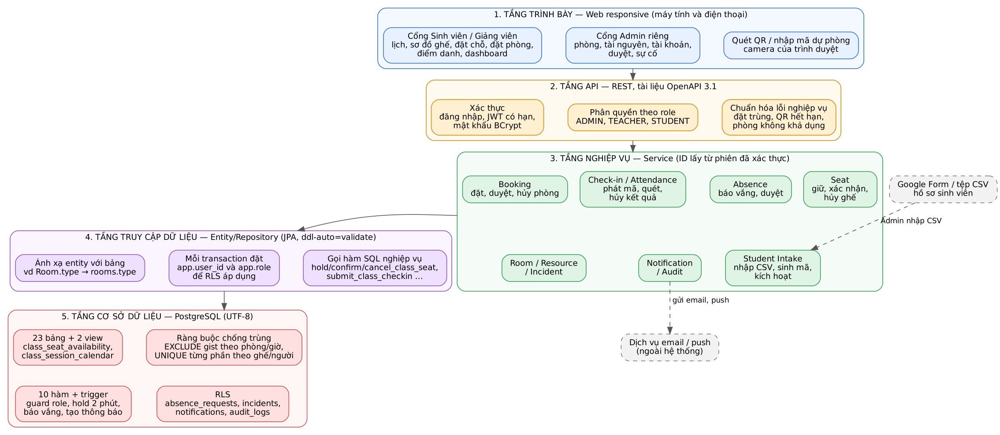

# Kiến trúc hệ thống

Hệ thống Smart Campus chia thành 5 tầng: trình bày, API, nghiệp vụ, truy cập dữ liệu và cơ sở dữ liệu. Đặc tả API xem tại [openapi-spec.yaml](openapi-spec.yaml).

*Hình 1. Kiến trúc phân tầng của hệ thống Smart Campus.*
