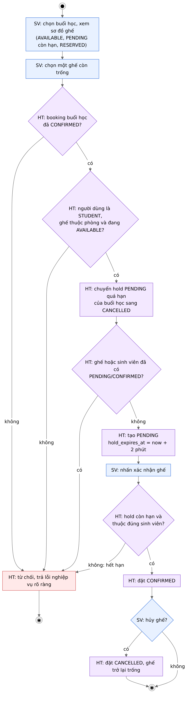
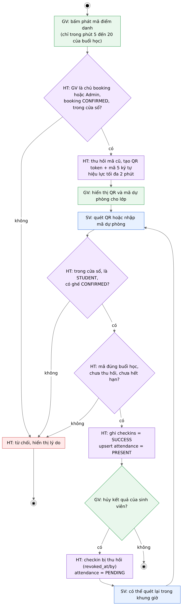
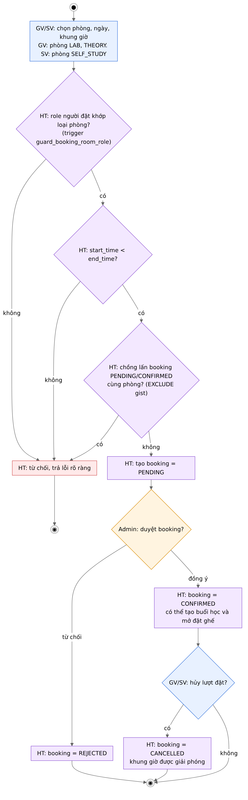
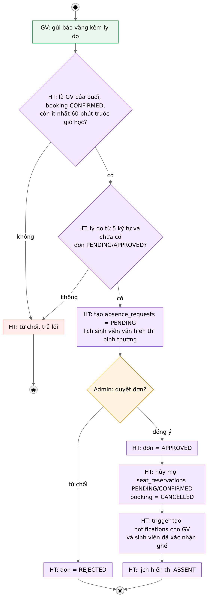
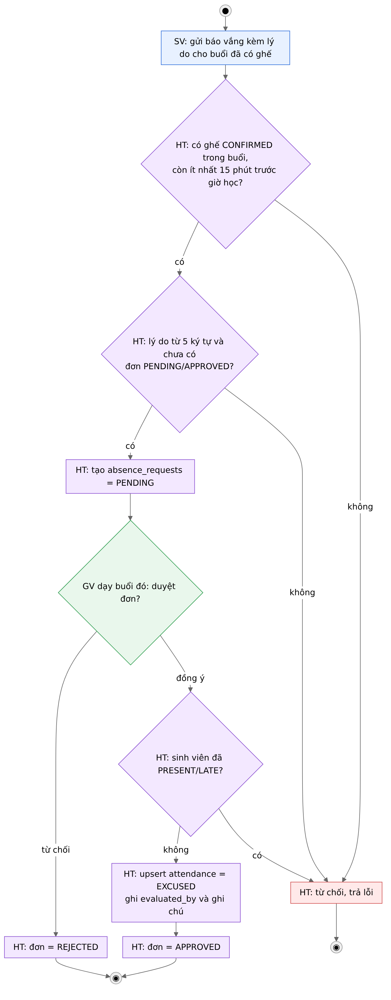

# Activity diagram

## Sinh viên và buổi học

*Hình 1. Activity diagram — Đặt chỗ ngồi.*

*Hình 2. Activity diagram — Điểm danh.*

## Đặt phòng

*Hình 3. Activity diagram — Đặt phòng.*

## Báo vắng

*Hình 4. Activity diagram — Báo vắng của giảng viên.*

*Hình 5. Activity diagram — Báo vắng của sinh viên.*
