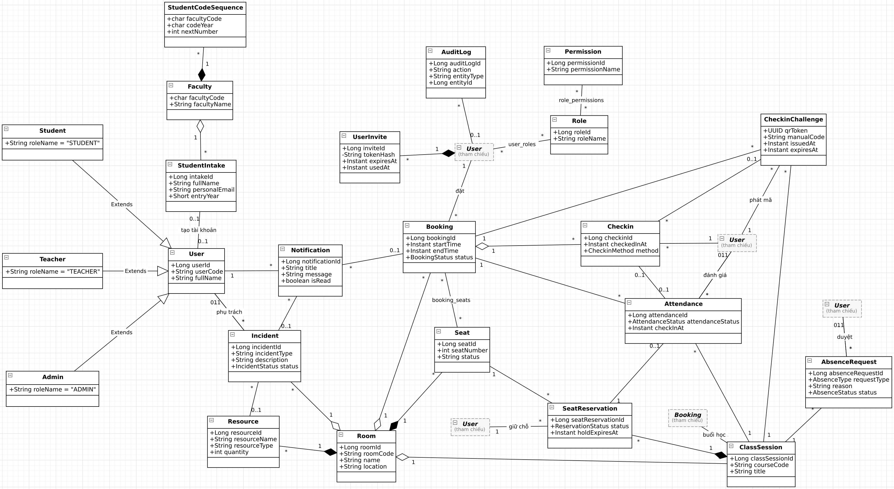
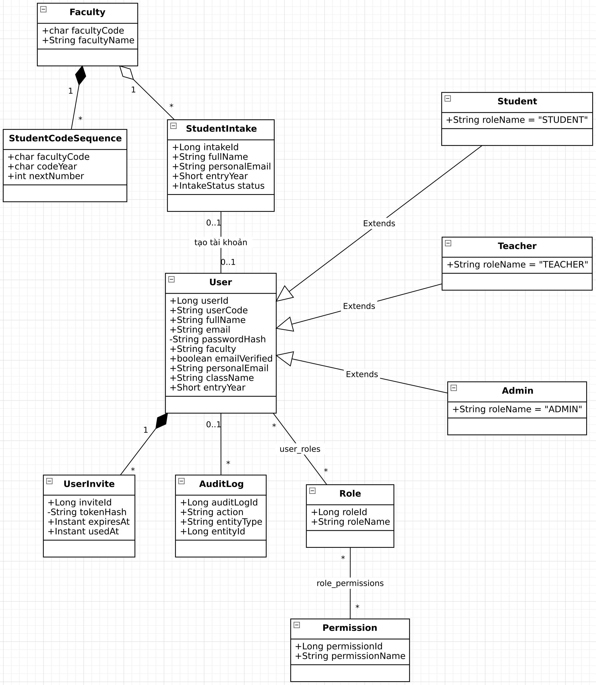
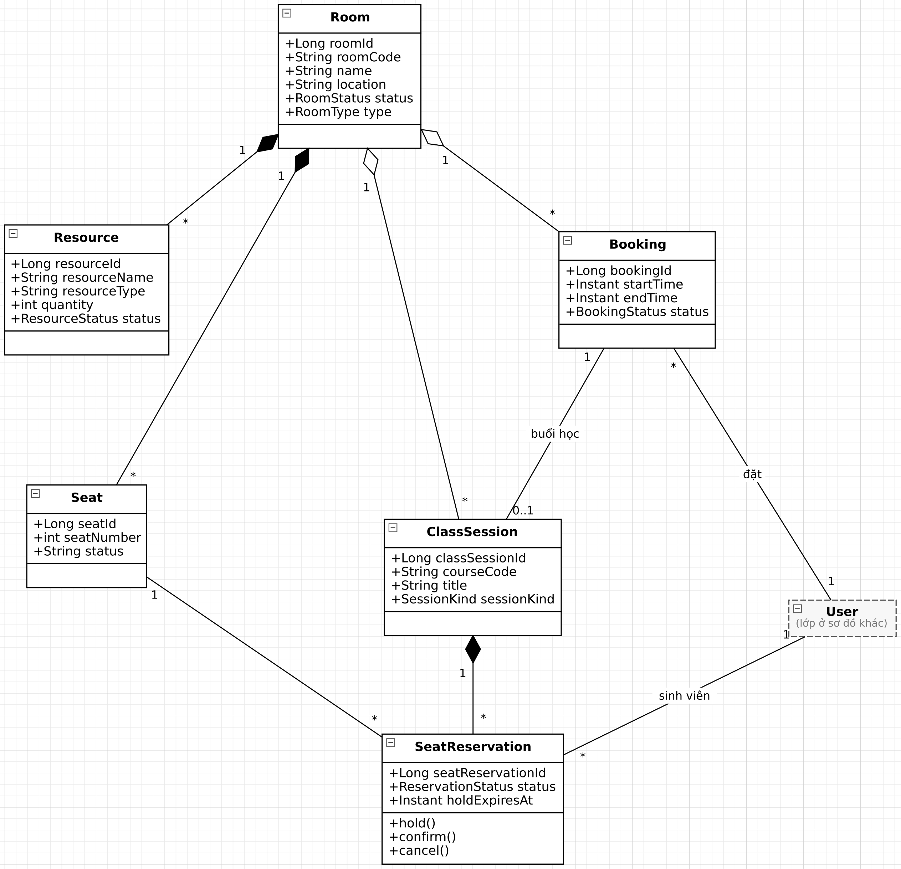
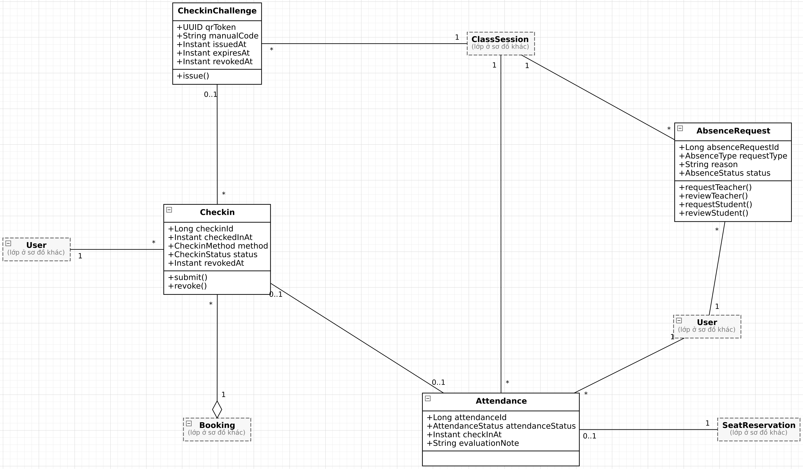
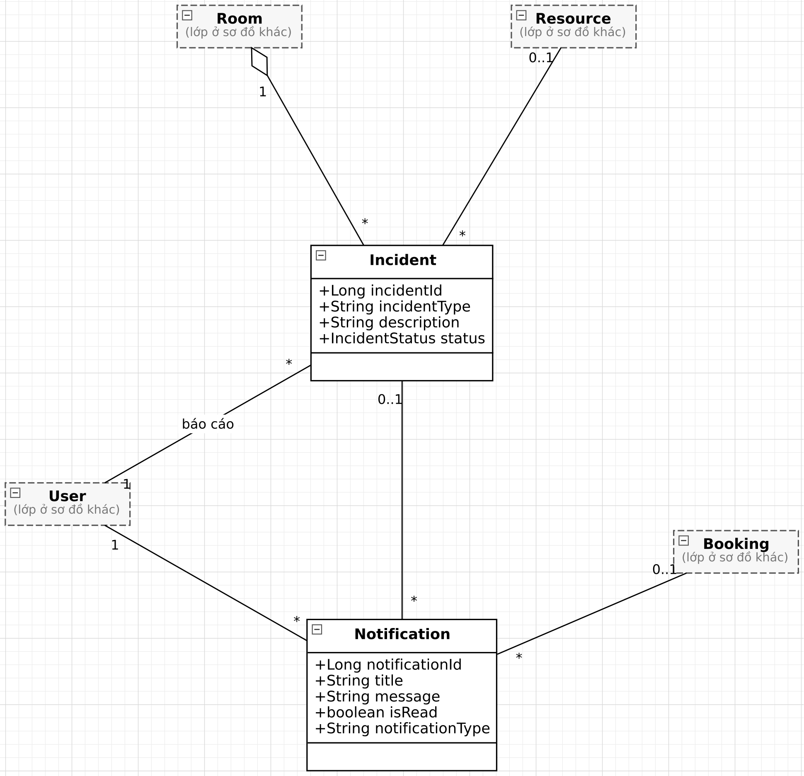

# Class diagram

*Hình 1. Class diagram tổng quát của hệ thống.*

## Theo nhóm chức năng

*Hình 2. Nhóm danh tính và phân quyền.*

*Hình 3. Nhóm phòng, đặt phòng và buổi học.*

*Hình 4. Nhóm điểm danh và báo vắng.*

*Hình 5. Nhóm sự cố và thông báo.*
