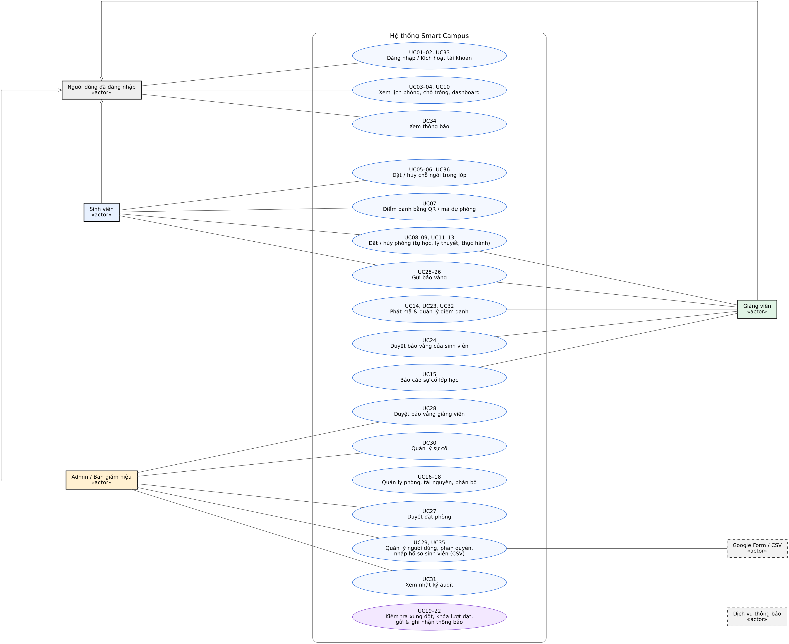
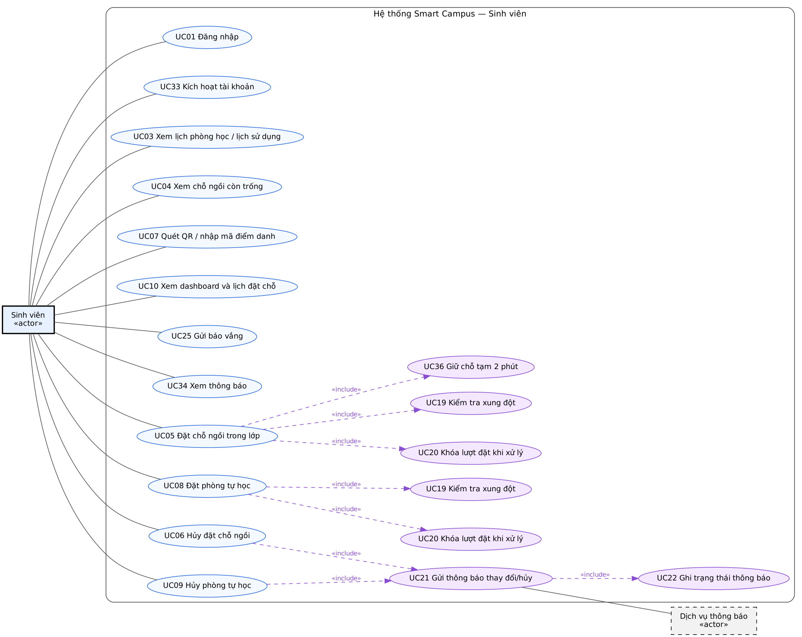
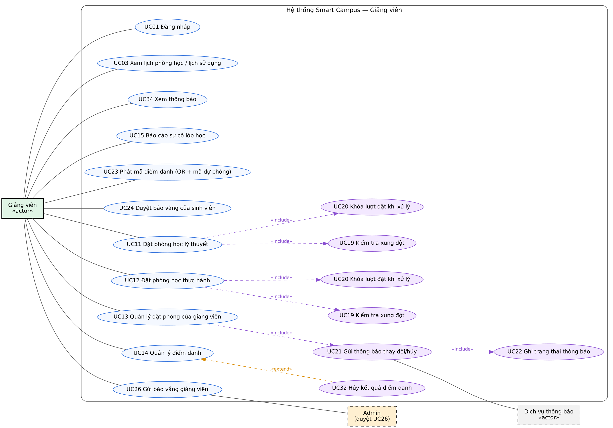
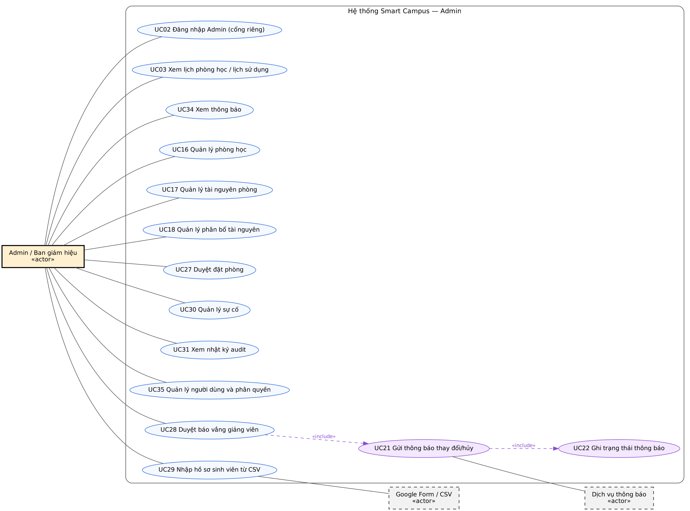
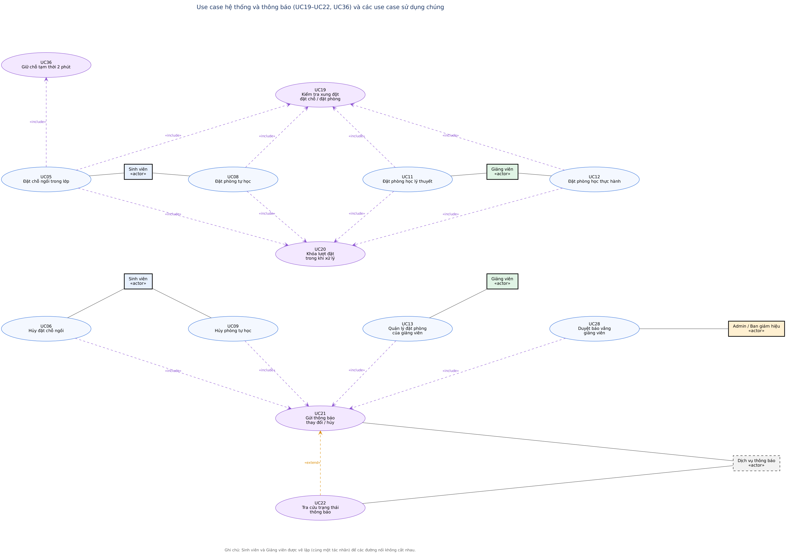

# Use case

*Hình 1. Use case tổng quát của hệ thống.*

## Theo tác nhân

*Hình 2. Use case của Sinh viên.*

*Hình 3. Use case của Giảng viên.*

*Hình 4. Use case của Admin / Ban giám hiệu.*

## Use case hệ thống

*Hình 5. Use case hệ thống và thông báo (UC19–UC22, UC36) cùng các use case sử dụng chúng.*
